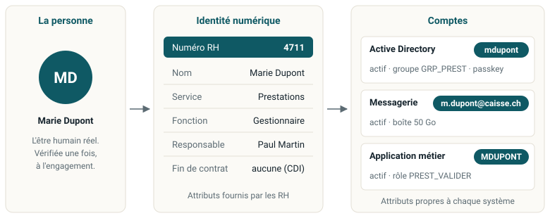

::: {.question-du-chapitre}
Avant de suivre Marie, il faut se mettre d'accord sur les mots. La majorité des malentendus dans
les projets IAM viennent de là.
:::

Dans un comité de projet, « supprimer le compte de Marie » peut vouloir dire désactiver son accès,
supprimer son identité dans le logiciel RH, ou effacer ses données. Ce sont trois actions
différentes, menées par trois équipes différentes.

## Identité, compte, identifiant, attribut

{.schema}

La personne
: L'être humain réel. Elle n'existe pas dans le système informatique. On vérifie qui elle est une
  fois, à l'engagement.

L'identité numérique
: Sa représentation dans l'organisation, avec ses attributs. Une personne peut en avoir plusieurs :
  Marie est employée de la caisse, et peut aussi en être assurée.

Les comptes
: Les objets techniques qui agissent dans chaque système. Une identité en a plusieurs : un compte
  Active Directory, une boîte de messagerie, un compte dans l'application métier.

Les attributs
: Les informations que portent l'identité et les comptes. Les **attributs d'identité** (numéro RH,
  nom, service, fonction, responsable, date de fin) viennent des RH et sont les mêmes dans tous les
  systèmes. Les **attributs de compte** (login, état, groupes, dernier accès) sont propres à chaque
  système et n'ont pas de sens en dehors.

L'identifiant
: L'attribut qui sert de clé : le numéro RH pour l'identité, le login pour le compte. C'est une
  étiquette, pas un objet : il ne porte ni secret ni droit.

Ces notions ne sont pas de même rang, et c'est ce qui crée les confusions. L'identité et le compte
sont des objets, des conteneurs. Les attributs sont les informations qu'ils portent. L'identifiant
est un attribut particulier, comme la clé primaire est une colonne parmi d'autres dans une table.

::: {.callout-tip title="Une analogie : le compte bancaire et l'IBAN"}
Le compte est le compte bancaire, l'identifiant est l'IBAN. L'IBAN permet de trouver le compte,
mais ce n'est pas lui qui contient l'argent. De même, `mdupont` permet de trouver le compte Active
Directory, mais c'est le compte qui porte le mot de passe, les groupes et l'état.
:::

Trois conséquences pratiques :

1. **Un compte peut avoir plusieurs identifiants** (login, adresse e-mail, identifiant technique
   Windows). Changer le login de Marie si elle change de nom ne crée pas un nouveau compte.
2. **Un identifiant peut exister avant le compte.** Le numéro RH 4711 existe le 25 octobre, le
   compte Active Directory est créé le 1^er^ novembre.
3. **Un identifiant ne doit jamais être réutilisé après un départ.** Sinon les journaux attribuent
   à la nouvelle personne les actions de l'ancienne.

Le travail d'un outil de gouvernance des identités (IGA) consiste à projeter les attributs
d'identité dans les attributs de compte : le service RH devient un groupe, la date de fin devient
l'état « désactivé ». Il détecte aussi les écarts : un compte actif dont l'identité a une date de
fin passée est un **compte orphelin**.

::: {.callout-important title="À retenir"}
Une personne ≠ une identité ≠ un compte.
:::

## Les quatre questions auxquelles l'IAM répond

::: {.cartes .deux}
::: {.carte}
### Qui es-tu ? L'identification
Je déclare une identité. Étape non sécurisée : n'importe qui peut prétendre s'appeler Marie.
:::

::: {.carte}
### Le prouves-tu ? L'authentification
Je fournis une preuve : mot de passe, clé de sécurité, certificat.
:::

::: {.carte}
### As-tu le droit ? L'autorisation
Le système décide. Étape séparée : être authentifié ne donne aucun droit en soi.
:::

::: {.carte}
### Qui a fait quoi ? La traçabilité
On enregistre ce qui se passe. Sans identité fiable au départ, les journaux ne prouvent rien.
:::
:::

Pensez à un immeuble : vous montrez votre carte (identification), le lecteur vérifie la puce
(authentification), la porte du troisième étage s'ouvre mais pas celle du cinquième (autorisation),
le journal enregistre votre passage (traçabilité).

::: {.callout-important title="L'erreur classique"}
Croire que l'autorisation découle automatiquement de l'authentification. Ce sont deux décisions
séparées, souvent prises par deux systèmes différents.

Exemple réel : une application web qui, après une connexion réussie auprès du fournisseur
d'identité, donne accès à toutes ses fonctions parce que « s'il l'a laissé passer, c'est qu'il a
le droit ». Le fournisseur d'identité n'a répondu qu'à la deuxième question.
:::

## Ce que couvre l'IAM : cinq domaines

::: {.cartes}
::: {.carte}
[A]{.num}

### Gestion des accès
Authentification, SSO, fédération, MFA. Tout ce qui se passe au moment de la connexion
(chapitres 5 à 7).

*Entra ID, Okta, Keycloak*
:::

::: {.carte}
[B]{.num}

### Gouvernance des identités (IGA)
Cycle de vie, création automatique des comptes, rôles, revues des accès, séparation des tâches
(chapitres 3, 4 et 8).

*SailPoint, Saviynt, Omada*
:::

::: {.carte}
[C]{.num}

### Comptes à privilèges (PAM)
Comptes administrateurs : changement automatique des mots de passe, droits accordés juste le temps
nécessaire, enregistrement des sessions (chapitre 8).

*CyberArk, BeyondTrust, Delinea*
:::

::: {.carte}
[D]{.num}

### Identités clients (CIAM)
Clients et citoyens : inscription en libre-service, consentement, grands volumes, confort
d'utilisation (chapitre 9).

*Auth0, Ping, Keycloak*
:::

::: {.carte}
[E]{.num}

### Identités non humaines
Services, machines, conteneurs, programmes automatiques. Aujourd'hui plus nombreux que les humains
(chapitre 9).

*HashiCorp Vault, SPIFFE/SPIRE*
:::
:::

Ces cinq domaines correspondent aux cinq familles de produits du marché. Quand vous arrivez sur un
projet, sachez dans quelle case vous vous trouvez, sinon vous comparerez des produits qui ne font
pas la même chose.

::: {.callout-important title="À retenir"}
Aucun éditeur ne couvre bien les cinq domaines : une architecture IAM est presque toujours un
assemblage de plusieurs produits.
:::

::: {.callout-note title="Références" collapse="true" icon=false}
ISO/IEC 24760-1:2019 pour les définitions (identité, attribut, identifiant). NIST SP 800-63-4, qui
traite séparément l'authentification (volume B) et la fédération (volume C).
:::
