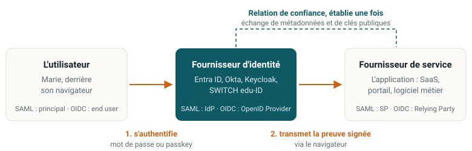

::: {.question-du-chapitre}
Marie utilise une quarantaine d'applications. Comment une seule authentification peut-elle servir à
toutes, sans que chacune voie son mot de passe ?
:::

## Le problème que la fédération résout

::: {.cartes .deux}
::: {.carte}
### Sans fédération

- Chaque application gère ses propres comptes : autant de bases de mots de passe, autant de fuites
  possibles, autant de comptes à fermer au départ d'un collaborateur.
- L'utilisateur réagit logiquement : il réutilise le même mot de passe partout. Une seule fuite
  compromet tout.
- Impossible de répondre à « à quoi Marie a-t-elle encore accès ? ».
- Fermer les accès devient un inventaire manuel, fait dans l'urgence, donc incomplet.
- Imposer le MFA suppose de le déployer trente fois, dans trente produits différents.
:::

::: {.carte}
### L'idée de la fédération

- Un seul système authentifie l'utilisateur.
- Toutes les applications lui font confiance et acceptent sa preuve signée, sans jamais voir le
  mot de passe.
- L'authentification devient un service central. La politique de sécurité s'applique en un seul
  endroit.
:::
:::

Le rapport Okta *Businesses at Work 2024* compte en moyenne plus de 90 applications par
organisation. Sans fédération, cela fait 90 bases de comptes à fermer au départ de chaque
collaborateur. Avec, imposer les passkeys à toute l'organisation est une modification dans le
fournisseur d'identité, pas 90 projets.

## Trois choses souvent confondues

::: {.cartes}
::: {.carte}
[1]{.num}

### Authentification unique (SSO)
Une seule authentification donne accès à plusieurs applications **à l'intérieur d'une même
organisation**.

*Exemple : Kerberos dans un domaine Active Directory. L'utilisateur ouvre sa session le matin et
n'a plus rien à taper.*
:::

::: {.carte}
[2]{.num}

### Fédération d'identité
Le SSO **franchit la frontière de l'organisation**. Deux entités distinctes établissent une
confiance explicite.

*Exemple : se connecter à un service SaaS avec le compte de son employeur, ou SWITCH edu-ID entre
hautes écoles suisses.*
:::

::: {.carte}
[3]{.num}

### Gestionnaire de mots de passe
L'outil connaît le mot de passe de chaque application et le tape à la place de l'utilisateur.

*Ce n'est pas de la fédération : les comptes locaux existent toujours et devront être fermés un
par un.*
:::
:::

::: {.callout-important title="À retenir"}
Le gestionnaire de mots de passe règle un problème de confort. Seule la fédération règle le
problème de gouvernance, parce qu'elle supprime les comptes locaux au lieu de les cacher.
:::

## Les trois rôles de toute fédération

{.schema}

L'utilisateur
: La personne qui veut accéder à l'application. Elle ne s'authentifie qu'à un seul endroit : le
  fournisseur d'identité.

Le fournisseur d'identité (IdP)
: Il authentifie l'utilisateur et émet une preuve signée (assertion SAML, jeton OIDC). Il devient
  l'élément le plus critique du système d'information.

Le fournisseur de service (SP)
: L'application. Elle reçoit la preuve, vérifie la signature, l'émetteur, le destinataire et la
  validité, puis ouvre une session et applique **ses propres règles d'autorisation**.

Ce vocabulaire est le même dans tous les protocoles, seuls les noms changent. L'apprendre ici évite
de le réapprendre trois fois.

**La relation de confiance s'établit une fois**, à la mise en place, pas à chaque connexion.
L'administrateur importe le fichier de métadonnées du fournisseur d'identité (avec son certificat
de signature) dans l'application, et l'adresse de l'application dans le fournisseur d'identité. À
partir de là, l'application croit tout ce que signe le fournisseur d'identité, et seulement cela.

**La fédération répond à « qui est-ce ? », pas à « que peut-il faire ? »**. L'application décide
elle-même de l'autorisation. Ce sont les quatre questions du [chapitre 1](01-bases.qmd).

::: {.callout-important title="Le revers"}
Le fournisseur d'identité devient le point unique de panne, et de compromission, de tout le système
d'information. En 2023, l'intrusion chez Okta a inquiété des milliers de clients d'un coup. Si
Entra ID tombe, Teams, Outlook et toutes les applications fédérées tombent ensemble.

Conséquence : il se protège comme un contrôleur de domaine. Comptes d'administration séparés, MFA
résistant au phishing obligatoire, journalisation, plan de secours.
:::

## Sous le capot du SSO web : sessions et cookies

::: {.etapes}
1. **L'utilisateur demande une page.** Un composant placé devant l'application (agent, serveur
   mandataire ou bibliothèque) intercepte la demande.
2. **Pas de cookie de session valide :** ce composant renvoie l'utilisateur vers le fournisseur
   d'identité.
3. **L'utilisateur s'authentifie une seule fois.** Le fournisseur d'identité crée sa propre
   session, matérialisée par un cookie sur son domaine.
4. **Retour à l'application avec une preuve** (assertion SAML ou jeton OIDC). L'application crée sa
   propre session locale : un second cookie.
5. **Pour la deuxième application,** le fournisseur d'identité a déjà une session : la preuve est
   émise sans rien demander. C'est cela, l'authentification unique.
6. **Déconnexion :** il faut fermer la session du fournisseur d'identité et toutes les sessions
   locales (déconnexion globale), sinon l'utilisateur reste connecté à certaines applications.
:::

::: {.callout-tip title="Le piège de la déconnexion"}
Un utilisateur clique sur « déconnexion » dans l'application A, puis ouvre l'application B dans le
même navigateur : il est toujours connecté, parce que la session du fournisseur d'identité n'a pas
été fermée. Sur un poste partagé (guichet, salle de classe), c'est un vrai problème.
:::

::: {.callout-important title="À retenir"}
Il existe toujours au moins deux sessions : celle du fournisseur d'identité et celle de
l'application. Durées de vie, révocation et déconnexion doivent être pensées pour les deux.
:::

Vous verrez ces deux sessions de vos propres yeux dans le [labo](../labo/index.qmd).

::: {.callout-note title="Références" collapse="true" icon=false}
NIST SP 800-63C-4 pour la définition de la fédération. OpenID Connect RP-Initiated Logout 1.0 et
SAML 2.0 Single Logout pour la déconnexion.
:::
