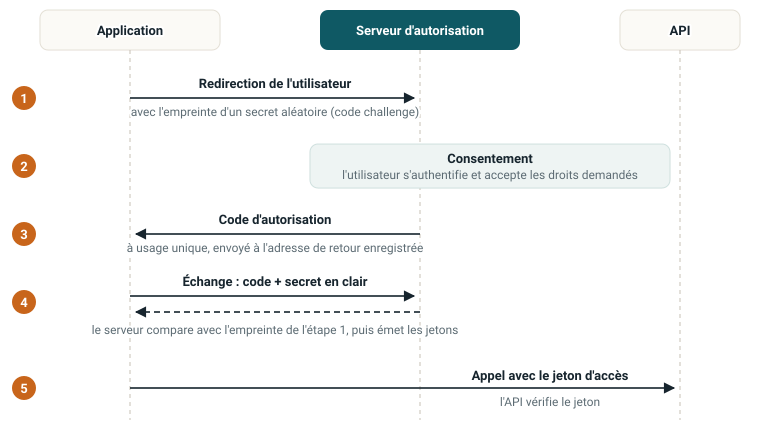

::: {.question-du-chapitre}
Comment les applications font-elles confiance au fournisseur d'identité, comment délèguent-elles un
accès, et comment les comptes de Marie y arrivent-ils ?
:::

C'est le chapitre le plus technique du cours. Nous le traitons par les schémas d'échange plutôt que
par les spécifications. Si vous êtes pressé, commencez par le
[tableau de décision](#quel-protocole).

## SAML 2.0 : l'échange, étape par étape

SAML date de 2005. Il est verbeux, fondé sur XML, et absolument partout dans les applications
d'entreprise. Il n'est pas dépassé.

::: {.etapes}
1. **L'utilisateur demande une page** à l'application (le fournisseur de service). *Marie ouvre
   Salesforce.*
2. **L'application voit qu'il n'a pas de session** et le renvoie vers le fournisseur d'identité
   avec une demande d'authentification. *Salesforce la renvoie vers `login.caisse.ch`.*
3. **Le fournisseur d'identité authentifie l'utilisateur :** mot de passe, MFA, ou session déjà
   ouverte. *Elle s'authentifie avec sa passkey.*
4. **Il produit une « assertion » :** un document XML signé qui contient l'identifiant et les
   attributs demandés.
5. **Le navigateur transmet l'assertion à l'application,** en général via un formulaire envoyé
   automatiquement.
6. **L'application vérifie la signature,** ouvre une session locale et applique ses propres règles
   d'autorisation.
:::

Variante : l'échange démarre depuis le portail d'entreprise. C'est plus pratique, mais l'étape 2
disparaît, et avec elle le lien entre la demande et la réponse. C'est une surface d'attaque en plus.

### Ce qu'il faut vérifier

::: {.cartes .deux}
::: {.carte}
### Ce que contient l'assertion

- `Issuer` : qui l'a émise.
- `Subject` : de qui il s'agit.
- `Conditions` : période de validité et destinataire attendu.
- `AuthnStatement` : comment l'utilisateur a été authentifié, et quand.
- `AttributeStatement` : les attributs transmis.
- `Signature` : la garantie que rien n'a été modifié et que l'émetteur est le bon.
:::

::: {.carte}
### Erreurs classiques d'intégration

- Signature non vérifiée, ou vérifiée sur le message et non sur l'assertion.
- Destinataire non contrôlé : on peut réutiliser une assertion sur une autre application.
- Pas de protection contre le rejeu de la même assertion.
- Certificat de signature expiré, renouvelé dans l'urgence un vendredi soir.
- Déconnexion globale jamais mise en place.
:::
:::

::: {.callout-important title="La date à mettre dans un agenda"}
Le certificat de signature du fournisseur d'identité a une date d'expiration. Le jour où il expire,
toutes les applications fédérées tombent en même temps. Cette date doit être dans un agenda, pas
seulement dans un fichier de configuration.
:::

## OAuth 2.0 : le malentendu de départ

::: {.cartes .deux}
::: {.carte}
### Ce qu'OAuth 2.0 fait

- Il délègue un droit d'accès à une ressource.
- Cas d'usage d'origine : permettre à une application de lire mon agenda sans lui donner mon mot
  de passe.
- Il produit un jeton d'accès (*access token*) destiné à une API.
- Ce jeton dit ce que son porteur peut faire, dans quelles limites (les *scopes*), et jusqu'à
  quand.
:::

::: {.carte}
### Ce qu'OAuth 2.0 ne fait pas

- Il ne dit pas qui est l'utilisateur, ni comment il a été authentifié, ni même s'il l'a été.
- Le jeton d'accès n'est pas destiné à l'application cliente mais à l'API. L'application ne doit
  pas le lire pour identifier l'utilisateur.
- Utiliser OAuth 2.0 seul pour authentifier est une erreur de conception connue depuis plus de dix
  ans, et toujours très répandue.
:::
:::

::: {.callout-important title="La formule à retenir"}
OAuth donne un ticket de consigne, pas une carte d'identité. Le ticket permet de récupérer un sac,
il ne dit pas qui vous êtes. C'est exactement le vide que comble OpenID Connect.
:::

::: {.callout-tip title="La mauvaise pratique, concrètement"}
Une application reçoit un jeton d'accès Google, appelle l'API de profil, lit l'adresse e-mail, et
considère l'utilisateur comme authentifié. Un jeton d'accès émis pour une autre application (un jeu
mobile, par exemple) permettrait de se connecter avec la même adresse e-mail.
:::

### Le flux à retenir : code d'autorisation + PKCE

{.schema}

::: {.etapes}
1. **Redirection.** L'application envoie l'utilisateur vers le serveur d'autorisation, avec
   l'empreinte d'un secret qu'elle vient de tirer au hasard (le *code challenge*).
2. **Consentement.** L'utilisateur s'authentifie auprès du serveur d'autorisation et accepte les
   droits demandés.
3. **Code.** Le serveur renvoie un code d'autorisation à usage unique, valable très peu de temps, à
   l'adresse de retour enregistrée à l'avance.
4. **Échange.** L'application échange le code contre un jeton, en présentant cette fois le secret
   en clair. Le serveur vérifie qu'il correspond à l'empreinte de l'étape 1.
5. **Appel.** L'application appelle l'API avec le jeton d'accès. L'API le vérifie.
:::

**Ce que PKCE empêche :** un attaquant qui intercepte le code ne peut rien en faire, car il ne
connaît pas le secret d'origine. PKCE était réservé au mobile. Il est aujourd'hui recommandé pour
tous les clients, y compris ceux qui peuvent garder un secret.

### Ce qui a été abandonné : vers OAuth 2.1

OAuth 2.1 est encore un projet à l'IETF. Il ne crée rien : il retire les mauvaises options et rend
obligatoires les bonnes pratiques déjà connues. Son intérêt : il liste noir sur blanc ce qu'il faut
retirer d'une intégration existante.

| Élément | Statut | Raison |
|------------------------------|-------------------------|---------------------------------------------|
| Flux implicite | [À ne plus utiliser]{.niveau .faible} | Le jeton passe dans l'URL : historique, journaux du serveur mandataire. |
| Mot de passe via l'application (ROPC) | [À ne plus utiliser]{.niveau .faible} | L'application manipule le mot de passe : plus aucun intérêt. |
| Jeton dans l'URL | [Interdit]{.niveau .faible} | Même problème que le flux implicite : fuite invisible. |
| PKCE | [Obligatoire]{.niveau .resistant} | Pour tous les clients, plus seulement le mobile. |
| Adresse de retour | [Comparaison exacte]{.niveau .resistant} | Avec un joker, le code part chez l'attaquant. |
| Jeton de rafraîchissement (client public) | [Rotation obligatoire]{.niveau .resistant} | Un jeton longue durée volé donne un accès durable et discret. |

## OpenID Connect : la couche d'authentification

OpenID Connect (OIDC) est une couche au-dessus d'OAuth 2.0. Trois ajouts seulement, mais ils
changent tout.

::: {.cartes}
::: {.carte}
[1]{.num}

### Le jeton d'identité
Un JWT signé qui décrit l'authentification : qui (`sub`), émis par qui (`iss`), pour quelle
application (`aud`), quand (`iat`), jusqu'à quand (`exp`), comment (`amr`, `acr`), et avec quel
code aléatoire (`nonce`).

C'est ce jeton, et lui seul, que l'application doit vérifier pour identifier l'utilisateur.
:::

::: {.carte}
[2]{.num}

### Le point d'information
Un service standard (*userinfo*) qui renvoie les attributs de l'utilisateur, regroupés par
familles : profil, e-mail, adresse, téléphone.

Fini les correspondances d'attributs à réinventer pour chaque application.
:::

::: {.carte}
[3]{.num}

### Découverte et clés publiques
Un document publié à une adresse convenue décrit tous les points d'accès du fournisseur. Un second
expose ses clés publiques de signature.

L'intégration devient automatisable.
:::
:::

::: {.callout-important title="La règle"}
Le jeton d'identité authentifie l'utilisateur auprès de l'application. Le jeton d'accès autorise
l'application auprès d'une API. Ne confondez jamais les deux usages.
:::

### Les trois jetons et comment les vérifier

| Jeton | Destinataire | Rôle | Durée de vie |
|------------------------|--------------------|--------------------------------|------------------------|
| **Jeton d'identité** (*ID token*) | L'application cliente | Prouver qu'une authentification a eu lieu, et dans quel contexte | Très courte, usage unique à la connexion |
| **Jeton d'accès** (*access token*) | L'API | Autoriser des appels d'API dans les limites des droits accordés | Quelques minutes à une heure |
| **Jeton de rafraîchissement** (*refresh token*) | Le serveur d'autorisation | Obtenir un nouveau jeton d'accès sans se réauthentifier | Longue, d'où la nécessité de le renouveler |

- **Un JWT est signé et encodé, pas chiffré.** N'importe qui peut lire son contenu : n'y mettez
  jamais de donnée sensible ni de secret. Collez-en un sur jwt.io, tout se lit sans aucune clé.
- **Vérification minimale côté serveur :** la signature (avec la clé publique du fournisseur), puis
  l'émetteur, le destinataire, la date d'expiration et, pour un jeton d'identité, le `nonce`.
- **Ne vous fiez jamais à l'en-tête du jeton pour choisir l'algorithme.** C'est l'origine de la
  faille classique où l'algorithme est mis à « aucun » : l'attaquant forge n'importe quelle
  identité.
- **Un jeton signé ne se révoque pas :** il reste valable jusqu'à son expiration. Un collaborateur
  licencié à 10 h garde un jeton d'accès valable jusqu'à 11 h. D'où des durées courtes, et une
  vérification côté serveur quand il faut révoquer immédiatement.

## SCIM : créer et fermer les comptes en standard

SAML et OIDC ne répondent pas à une question : comment créer, mettre à jour et désactiver le
compte dans l'application cible ?

SCIM est une API standard, avec deux objets principaux (Utilisateur et Groupe) et un schéma
d'attributs commun. Sans SCIM, il reste deux mauvaises solutions : le fichier déposé chaque nuit,
ou la création automatique du compte à la première connexion. Cette création à la volée est
confortable et dangereuse : elle sait ouvrir un compte, jamais le fermer.

::: {.callout-important title="La règle des deux canaux"}
- **SAML ou OIDC :** le canal d'authentification, à chaque connexion.
- **SCIM :** le canal du cycle de vie, à chaque événement RH.

Les deux sont nécessaires. Une intégration qui n'a que le premier fabrique des comptes orphelins.
:::

::: {.callout-tip title="Exemple"}
Une organisation fédère 40 applications SaaS en SAML et se félicite. Deux ans plus tard, l'audit
trouve 300 comptes d'anciens collaborateurs dans ces applications. La fédération les empêche de se
connecter, mais les comptes, leurs données et parfois leurs licences payantes existent toujours.
:::

La prise en charge de SCIM par les éditeurs est très inégale. À vérifier dans tout contrat SaaS :
le fournisseur propose-t-il SCIM, et sa version gère-t-elle vraiment la désactivation ? Testez-le
avant de signer.

## Quel protocole pour quel usage {#quel-protocole}

| Besoin | Protocole | Remarque |
|----------------------------------|----------------------|--------------------------------------------|
| Connecter un logiciel d'entreprise au fournisseur d'identité | **SAML 2.0** | Le plus largement pris en charge par les applications installées en entreprise |
| Authentifier sur une application web ou mobile | **OpenID Connect** | Plus léger, adapté au mobile et aux applications web modernes |
| Autoriser l'appel d'une API | **OAuth 2.0 / 2.1** | Code d'autorisation avec PKCE. Jamais le flux implicite |
| Créer, modifier et désactiver des comptes | **SCIM 2.0** | Indispensable en complément de la fédération, jamais à sa place |
| Authentifier une machine, sans utilisateur | **OAuth client credentials** | Avec un certificat plutôt qu'un secret partagé |
| SSO dans un domaine Windows | **Kerberos** | Ancien, efficace, limité au réseau interne et aux machines du domaine |
| Résister au phishing à la connexion | **FIDO2 / WebAuthn** | S'ajoute aux précédents : c'est le facteur, pas le protocole de fédération |

## Quatre attaques sur les protocoles de fédération

::: {.cartes .deux}
::: {.carte}
[1]{.num}

### Détournement de l'adresse de retour
Une adresse de retour comparée approximativement livre le code d'autorisation à un domaine de
l'attaquant.

**Parade :** comparaison exacte, sans joker.
:::

::: {.carte}
[2]{.num}

### L'intermédiaire trompé
Un service de confiance utilise ses propres droits pour le compte d'un tiers, sans vérifier au nom
de qui il agit (*confused deputy*).

**Parade :** un jeton au nom de l'utilisateur, pas l'identité du service.
:::

::: {.carte}
[3]{.num}

### Phishing au consentement
Une application malveillante obtient le droit de lire les e-mails. Aucun mot de passe volé, et
l'accès survit à son changement.

**Parade :** liste blanche d'applications, validation des droits sensibles.
:::

::: {.carte}
[4]{.num}

### Rejeu de jeton et de session
Un jeton ou un cookie volé est réutilisé depuis un autre appareil. L'authentification forte a déjà
eu lieu.

**Parade :** jeton lié au client, durées courtes, réévaluation du contexte.
:::
:::

::: {.callout-important title="Le point commun aux quatre"}
L'authentification était correcte. La faille est dans la délégation, c'est-à-dire dans
l'autorisation. C'est ce qui la rend si difficile à détecter.
:::

L'intermédiaire trompé revient dans tous les systèmes délégués, y compris les agents IA : un
assistant interne qui a lui-même le droit de lire tous les documents, et qui répond à n'importe
quel utilisateur avec ces droits. Il devrait agir avec un jeton obtenu au nom de l'utilisateur.

Pour voir ces échanges en vrai, faites le [labo](../labo/index.qmd).

::: {.callout-note title="Références" collapse="true" icon=false}
OASIS SAML 2.0 et OWASP SAML Security Cheat Sheet. RFC 6749 (OAuth 2.0), RFC 7636 (PKCE), RFC 9700
(bonnes pratiques de sécurité OAuth, janvier 2025), RFC 8693 (échange de jeton). OpenID Connect
Core 1.0. RFC 8725 (bonnes pratiques JWT), RFC 7662 (introspection). RFC 7643 et 7644 (SCIM).
:::
