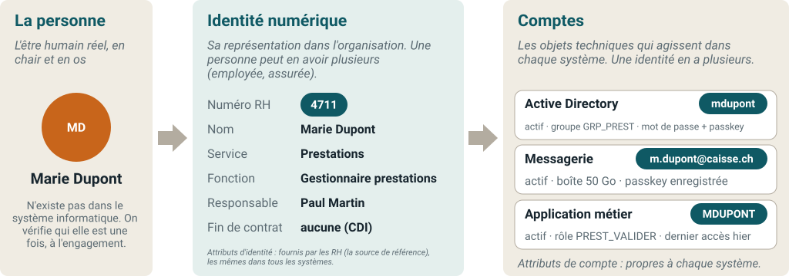

## Une identité et ses droits {.separateur .partie}

[Partie 1]{.numero}

[Les bases, les annuaires, le cycle de vie, l'autorisation, l'authentification]{.sous-titre}

## Les bases {.separateur}

[01]{.numero}

[Vocabulaire, les quatre questions, la carte du domaine]{.sous-titre}

::: {.bandeau}
[Fil rouge :]{.fil-rouge} *avant de suivre Marie, se mettre d'accord sur les mots.*
:::

## Identité, compte, identifiant, attribut

[Vocabulaire]{.surtitre}

::: {.cadre style="gap: 14px;"}
{.schema fig-alt="La personne (Marie Dupont), son identité numérique (numéro RH 4711, nom, service, fonction, responsable, fin de contrat) et ses trois comptes (Active Directory mdupont, messagerie m.dupont@caisse.ch, application métier MDUPONT)."}

::: {.bandeau}
Une personne ≠ une identité ≠ un compte. L'identifiant (en bleu) est l'attribut qui sert de clé : numéro RH pour l'identité, login pour le compte. C'est une étiquette, pas un objet : il ne porte ni secret ni droit.
:::
:::

## Les questions auxquelles l'IAM répond

[Les quatre questions]{.surtitre}

::: {.cadre}
::: {.grille .c2}
::: {.carte}
[[?]{.pastille} Qui es-tu ? Identification]{.tete}

Je déclare une identité. Étape non sécurisée : n'importe qui peut prétendre s'appeler Marie.
:::

::: {.carte}
[[!]{.pastille} Le prouves-tu ? Authentification]{.tete}

Je fournis une preuve : mot de passe, clé de sécurité, certificat.
:::

::: {.carte}
[[→]{.pastille} As-tu le droit ? Autorisation]{.tete}

Le système décide. Étape séparée : être authentifié ne donne aucun droit en soi.
:::

::: {.carte}
[[≡]{.pastille} Qui a fait quoi ? Traçabilité]{.tete}

On enregistre ce qui se passe. Sans identité fiable au départ, les journaux ne prouvent rien.
:::
:::

::: {.bandeau}
L'erreur classique : croire que l'autorisation découle automatiquement de l'authentification. Ce sont deux décisions séparées, souvent prises par deux systèmes différents.
:::
:::

## Ce que couvre l'IAM : cinq domaines

[Cartographie]{.surtitre}

::: {.cadre}
::: {.grille .c3 style="grid-template-rows: 237fr 192fr; gap: 25px 26px;"}
::: {.carte}
[[A]{.pastille} Gestion des accès (Access Management)]{.tete}

Authentification, SSO, fédération, MFA. Tout ce qui se passe au moment de la connexion (chapitres 5 à 7).
:::

::: {.carte}
[[B]{.pastille} Gouvernance des identités (IGA)]{.tete}

Cycle de vie, création automatique des comptes, rôles, revues des accès, séparation des tâches (chapitres 3, 4 et 8).
:::

::: {.carte}
[[C]{.pastille} Comptes à privilèges (PAM)]{.tete}

Comptes administrateurs : changement automatique des mots de passe, droits accordés juste le temps nécessaire, enregistrement des sessions (chapitre 8).
:::

::: {.carte}
[[D]{.pastille} Identités clients (CIAM)]{.tete}

Clients et citoyens : inscription en libre-service, consentement, grands volumes, confort d'utilisation (chapitre 9).
:::

::: {.carte}
[[E]{.pastille} Identités non humaines]{.tete}

Services, machines, conteneurs, programmes automatiques. Aujourd'hui plus nombreux que les humains (chapitre 9).
:::

::: {.carte .retenir}
[À retenir]{.tete}

Aucun éditeur ne couvre bien les cinq domaines : une architecture IAM est presque toujours un assemblage de plusieurs produits.
:::
:::
:::
