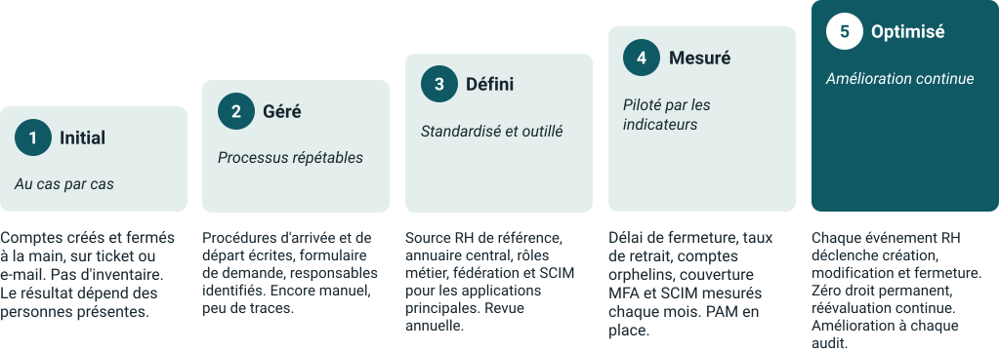

## Le cycle de vie de l'identité {.separateur}

[03]{.numero}

[Création, vie, suppression]{.sous-titre}

## Trois moments clés : création, vie, suppression {style="--corps: 19.6px; --tete-etape: 21.3px; --pastille: 43px; --ecart: 18px;"}

[Cycle de vie : vue d'ensemble]{.surtitre}

::: {.cadre}
::: {.etapes}
1. **Recrutement**\
   Création dans le logiciel RH. Rien n'existe encore côté informatique.
2. **Création : l'arrivée (Joiner)**\
   Ouverture des accès : compte, messagerie, droits du poste. Objectif : être opérationnel dès le premier jour.
3. **Vie : le changement de poste (Mover)**\
   Changement de fonction, de service, de site. Le point faible de toutes les organisations.
4. **Vie : les événements**\
   Demandes d'accès, congé maternité, suspension, longue absence, changement de nom, retour.
5. **Suppression : le départ (Leaver)**\
   Blocage immédiat des accès, puis suppression après le délai de conservation.
:::

::: {.bandeau}
Règle d'or : chaque étape doit être déclenchée par un événement dans le système RH, jamais par un e-mail envoyé au support.
:::
:::

## L'arrivée de Marie, étape par étape {style="--corps: 16.9px; --tete-etape: 18.7px; --pastille: 43px; --ecart: 12px; --rangs: 3;"}

[Cycle de vie : création]{.surtitre}

::: {.cadre}
::: {.etapes .c2}
1. **Saisie par les RH**\
   Contrat, date de début, fonction, service, responsable. Pour un externe : saisi par le responsable interne, avec une date de fin obligatoire.
2. **Vérification de l'identité**\
   Pièce d'identité contrôlée à l'engagement. C'est le seul moment où l'on vérifie le lien entre la personne réelle et son identité numérique (niveau IAL, chapitre 8).
3. **Calcul des accès**\
   L'outil IGA crée l'identité et déduit les accès du poste (rôle métier « gestionnaire de prestations »). Approbation seulement pour ce qui sort du standard.
4. **Création des comptes**\
   Automatique dans les applications connectées (SCIM, connecteurs), ticket contrôlé pour les autres. Identifiant unique, jamais réutilisé après un départ.
5. **Remise des identifiants**\
   Mot de passe initial à usage unique, remis en personne ou par un canal séparé, changé à la première connexion. MFA ou passkey enregistré le premier jour, jamais par e-mail.
6. **Jour 1**\
   Marie est opérationnelle. Tout est journalisé et rattaché à son identité. Elle reçoit les consignes : phishing, et surtout comment récupérer son accès si elle perd son téléphone.
:::

::: {.bandeau}
Ce que le métier voit : le délai d'ouverture. Ce que la sécurité prépare dès ce jour : la suppression. Sans identifiant unique, sans source de référence et sans date de fin, il n'y aura pas de départ propre.
:::
:::

## Demander et approuver un accès {style="--corps: 16px; --tete: 19.6px; --pastille: 43px;"}

[Cycle de vie : vie]{.surtitre}

::: {.cadre}
::: {.grille style="grid-template-columns: repeat(6, 1fr); grid-template-rows: 180fr 152fr; gap: 26px 25px;"}
::: {.carte style="grid-column: span 2;"}
[[1]{.pastille} Demande en libre-service]{.tete}

L'utilisateur ou son responsable choisit dans un catalogue d'accès décrit en langage métier, avec une justification et une durée.
:::

::: {.carte style="grid-column: span 2;"}
[[2]{.pastille} Approbation]{.tete}

Le responsable hiérarchique, puis le propriétaire de l'application pour les accès sensibles. Délégation pendant les absences, rappels automatiques.
:::

::: {.carte style="grid-column: span 2;"}
[[3]{.pastille} Contrôle des conflits]{.tete}

L'outil vérifie que le nouvel accès ne crée pas une combinaison interdite (créer un fournisseur et le payer). Sinon : refus, ou dérogation documentée.
:::

::: {.carte style="grid-column: span 3;"}
[[4]{.pastille} Attribution automatique]{.tete}

L'accès est créé dans l'application par le connecteur ou SCIM ; l'utilisateur est informé. Tout est tracé : qui a demandé, qui a validé, quand.
:::

::: {.carte style="grid-column: span 3;"}
[[5]{.pastille} Durée et retrait]{.tete}

Chaque accès a une date de fin ou passe par la revue des accès suivante. Un accès temporaire se retire tout seul.
:::
:::

::: {.bandeau}
Si le catalogue est écrit en langage technique, personne ne sait quoi demander, et le responsable approuve « la même chose que Marie ». La qualité du catalogue fait la qualité du processus.
:::
:::

## Changement de poste : les droits s'accumulent {style="--corps: 24.9px; --interligne: .45em; --grand: 71px;"}

[Cycle de vie : vie]{.surtitre}

::: {.cadre}
::: {.grille style="grid-template-columns: 652fr 332fr; gap: 39px;"}
::: {}
- [**2014 :**]{.sarcelle} Comptabilité
- [**2017 :**]{.sarcelle} Contrôle de gestion
- [**2020 :**]{.sarcelle} Achats
- [**2023 :**]{.sarcelle} Direction financière
- [**2026 : cumul de tous les droits, que personne n'a décidé**]{.ambre}

[Chaque changement de poste ajoute des droits. Presque aucun n'en retire.]{.doux style="display: block; margin-top: 24px; font-size: 24.9px; line-height: 1.3;"}
:::

::: {.carte .chiffre .gauche style="--corps: 19.6px; margin-bottom: 30px;"}
[Résultat]{.etiquette style="font-size: 16px;"}

[5 postes]{.grand}

Un collaborateur qui a changé cinq fois de service en douze ans détient les droits des cinq postes réunis. C'est, sans le dire, un compte à privilèges.
:::
:::

::: {.bandeau}
Ce phénomène porte un nom : l'accumulation de droits (privilege creep). Elle transforme un utilisateur ordinaire en cible de grande valeur.
:::
:::

## Le départ de Marie, étape par étape {style="--corps: 16.9px; --tete-etape: 18.7px; --pastille: 43px; --ecart: 10px; --rangs: 3;"}

[Cycle de vie : suppression]{.surtitre}

::: {.cadre}
::: {.etapes .c2}
1. **L'événement**\
   Le départ vient du logiciel RH (date de fin) ou de la date de fin du contrat externe. Jamais d'un e-mail au support. Départ immédiat (licenciement, soupçon) : procédure d'urgence, en heures, pas en jours.
2. **Blocage**\
   Désactivation de l'authentification à l'IdP, et révocation des sessions et jetons en cours (chapitre 7 : un jeton signé reste valable jusqu'à son expiration).
3. **Comptes**\
   Désactivation, pas suppression, dans chaque application : SCIM et connecteurs pour les applications connectées, liste contrôlée pour les autres. Badges et matériel récupérés.
4. **Secrets partagés**\
   Changement des mots de passe partagés, comptes de service et clés que Marie connaissait. Retrait de ses droits d'administration et de ses délégations.
5. **Transfert**\
   Messagerie, fichiers, rôles d'approbateur ou de propriétaire d'application réattribués à son responsable, avec une durée limitée.
6. **Suppression définitive**\
   Après le délai de conservation (obligations légales, LPD), suppression des données personnelles. Les journaux d'audit restent, avec un accès restreint.
:::

::: {.bandeau}
Mesure à suivre : délai entre la date de départ et la désactivation effective. Objectif : moins de 24 heures, et moins d'une heure pour un départ immédiat.
:::
:::

## Où en est votre organisation ? Cinq niveaux de maturité (CMMI)

[Cycle de vie : maturité]{.surtitre}

::: {.cadre}
{.schema fig-alt="Cinq niveaux de maturité en escalier. 1 Initial, au cas par cas : comptes créés et fermés à la main, sur ticket ou e-mail, pas d'inventaire. 2 Géré, processus répétables : procédures d'arrivée et de départ écrites, encore manuel. 3 Défini, standardisé et outillé : source RH de référence, annuaire central, rôles métier, fédération et SCIM, revue annuelle. 4 Mesuré, piloté par les indicateurs : délai de fermeture, taux de retrait, comptes orphelins, couverture MFA et SCIM mesurés chaque mois, PAM en place. 5 Optimisé, amélioration continue : chaque événement RH déclenche création, modification et fermeture, zéro droit permanent."}

::: {.bandeau}
La plupart des organisations se situent entre 2 et 3. Le passage de 3 à 4 est celui qui change la sécurité : on commence à mesurer le délai de fermeture des accès, et plus seulement le délai d'ouverture.
:::
:::
