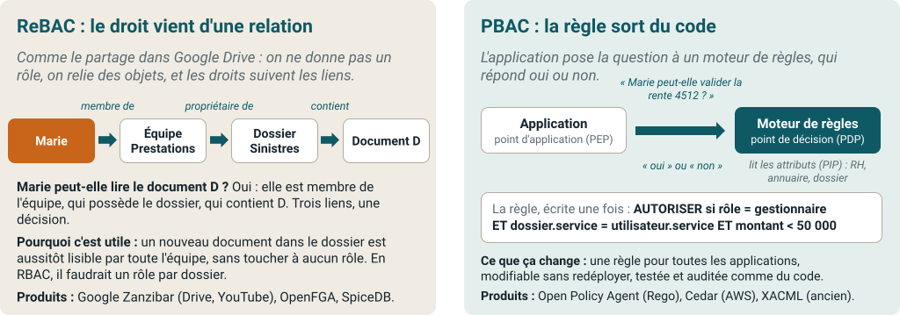

## L'autorisation {.separateur}

[04]{.numero}

[DAC, MAC, RBAC, ABAC, ReBAC, principes, modèle de rôles]{.sous-titre}

## Les deux modèles historiques : DAC et MAC {style="--corps: 19.6px; --tete: 23.1px;"}

[Autorisation]{.surtitre}

::: {.cadre}
::: {.grille .c2}
::: {.carte .panneau}
[DAC : le propriétaire décide]{.tete}

- Le propriétaire d'un fichier ou d'un dossier choisit qui y accède.
- C'est le modèle des partages de fichiers classiques et du cloud (Drive, SharePoint).
- Souple, immédiat, compris de tous.
- Faiblesse : la politique de sécurité est éparpillée chez des milliers d'utilisateurs. Personne n'a de vue d'ensemble.
- C'est ainsi que naissent les dossiers partagés accessibles à toute l'entreprise.
:::

::: {.carte .panneau .avant}
[MAC : une autorité centrale décide]{.tete}

- Une autorité centrale fixe les règles. Le propriétaire ne peut pas y déroger.
- Fondé sur des niveaux de classification (confidentiel, secret…) et des habilitations.
- Modèle militaire, repris par SELinux et AppArmor.
- Très fort pour la confidentialité, très lourd au quotidien.
- Peu utilisé tel quel en entreprise, mais ses idées reviennent dans la classification des données.
:::
:::

::: {.bandeau}
Aucun des deux n'est « le bon » : ils répondent à des menaces différentes.
:::
:::

## RBAC : le modèle le plus utilisé en entreprise {style="--corps: 18.7px;"}

[Autorisation]{.surtitre}

::: {.cadre style="gap: 26px;"}
{.schema fig-alt="Chaîne RBAC : l'utilisateur Marie Dupont reçoit le rôle gestionnaire de prestations, qui porte la permission valider une rente inférieure à 50 000 CHF, sur la ressource application de gestion des prestations."}

::: {.grille .c3}
::: {.carte .panneau}
[Le principe]{.tete}

L'utilisateur reçoit des rôles ; le rôle porte les permissions. Aucun droit n'est jamais donné directement à une personne. C'est cette indirection qui rend le modèle lisible et auditable.
:::

::: {.carte .panneau}
[Rôle métier et rôle technique]{.tete}

Rôle métier : ce qu'un poste fait (« gestionnaire de prestations »). Rôle technique : ce qu'une application autorise (« PREST_VALIDER »). Un rôle métier regroupe plusieurs rôles techniques : cette traduction coûte cher à maintenir.
:::

::: {.carte .panneau}
[Ce que ça apporte]{.tete}

Répondre à la question d'audit « qui peut valider une rente ? » sans ouvrir chaque application. Donner les bons accès dès le jour 1. Retirer d'un coup tous les droits d'un poste lors d'un changement.
:::
:::
:::

## La limite du RBAC : l'explosion du nombre de rôles {style="--corps: 21.3px; --interligne: .6em; --grand: 71px;"}

[Autorisation]{.surtitre}

::: {.cadre}
::: {.grille style="grid-template-columns: 652fr 332fr; gap: 39px; margin-bottom: 14px;"}
::: {}
- Chaque exception demandée par le métier crée un nouveau rôle : « gestionnaire de prestations, site de Lausanne, hors rentes d'invalidité ».
- Le nombre de rôles se multiplie avec chaque critère : fonction × site × type de client × niveau de délégation.
- Signal mesurable : quand il y a presque autant de rôles que d'utilisateurs, le modèle ne simplifie plus rien.
- Deuxième signal : plus personne ne sait ce que contient un rôle, donc les revues des accès sont validées les yeux fermés.
- Solutions : hiérarchie de rôles, séparation stricte rôles métier / rôles techniques, et surtout accepter que le RBAC ne couvre pas tout.
:::

::: {.carte .chiffre .gauche style="--corps: 19.6px;"}
[Le signal d'alarme]{.etiquette style="font-size: 16px; margin-top: 4px;"}

[2 400]{.grand}

rôles pour 2 000 collaborateurs. À ce stade, chaque rôle décrit une personne. Le modèle a été respecté à la lettre et vidé de son sens.
:::
:::
:::

## ABAC : décider à partir d'attributs {style="--corps: 16px; --tete: 19.6px;"}

[Autorisation]{.surtitre}

::: {.cadre}
::: {.grille style="grid-template-columns: repeat(4, 1fr); grid-template-rows: 165fr 167fr; gap: 26px;"}
::: {.carte .panneau}
[Attributs de la personne]{.tete}

Service, fonction, niveau d'habilitation, ancienneté, appareil conforme.
:::

::: {.carte .panneau}
[Attributs de la ressource]{.tete}

Classification, propriétaire, service rattaché, montant, statut du dossier.
:::

::: {.carte .panneau}
[Attributs de l'action]{.tete}

Lecture, écriture, export, suppression, validation.
:::

::: {.carte .panneau}
[Attributs du contexte]{.tete}

Heure, adresse réseau, pays, niveau de risque de la session, moyen d'authentification utilisé.
:::

::: {.carte .panneau .avant style="grid-column: span 2;"}
[Ce que l'ABAC apporte]{.tete}

Souplesse : une règle remplace des centaines de rôles.

Décision selon le contexte : le même utilisateur n'a pas les mêmes droits selon l'appareil ou l'heure.
:::

::: {.carte .panneau .avant style="grid-column: span 2;"}
[Ce qu'il coûte]{.tete}

Il faut des attributs fiables et à jour, partout. C'est le vrai obstacle.

Répondre à « qui peut faire quoi ? » redevient difficile : il faut calculer les règles, pas les lire.
:::
:::

::: {.bandeau}
Exemple de règle : Marie peut lire un dossier d'assuré SI son service = service du dossier ET son appareil est conforme ET il est entre 7 h et 20 h.
:::
:::

## ReBAC et PBAC : sortir l'autorisation du code

[Autorisation]{.surtitre}

::: {.cadre}
{.schema fig-alt="ReBAC : Marie est membre de l'équipe Prestations, qui est propriétaire du dossier Sinistres, qui contient le document D ; Marie peut donc lire le document D. PBAC : l'application, point d'application (PEP), demande au moteur de règles, point de décision (PDP), si Marie peut valider la rente 4512 ; le moteur lit les attributs (PIP) et répond oui ou non selon une règle écrite une fois."}

::: {.bandeau}
Point commun : la décision sort du code applicatif. ReBAC répond à « qui est lié à quoi », PBAC à « quelle règle s'applique ». Un « if » caché dans une application n'est ni auditable, ni modifiable, ni testable.
:::
:::

## Choisir un modèle : il n'y a pas de gagnant {style="--corps: 16.9px; --pad-cellule: 9px;"}

[Synthèse]{.surtitre}

::: {.cadre}
| Modèle | Décide selon                | Point fort                   | Point faible                              | Contexte typique                          |
|-----------|---------------------|---------------------|----------------------|-------------------------|
| DAC    | Le choix du propriétaire    | Simple, autonome             | Aucune vue d'ensemble                     | Partages de fichiers, outils collaboratifs |
| MAC    | Une classification imposée  | Confidentialité forte        | Très rigide au quotidien                  | Défense, systèmes durcis                  |
| RBAC   | Le rôle de l'utilisateur    | Auditable, compris du métier | Explosion du nombre de rôles              | Entreprise, applications métier           |
| ABAC   | Des attributs et le contexte | Souple, règles très précises | Dépend d'attributs fiables                | Accès conditionnel, données sensibles     |
| ReBAC  | Les relations entre objets  | Partage et héritage naturels | Outils encore jeunes, complexe à raisonner | SaaS multi-clients, collaboratif          |

::: {.bandeau}
En pratique, les architectures matures combinent : RBAC pour la base et la preuve d'audit, ABAC pour les conditions d'accès, ReBAC pour le partage entre utilisateurs.
:::
:::

## Deux principes qui structurent tout le reste {style="--corps: 19.6px; --tete: 23.1px;"}

[Principes]{.surtitre}

::: {.cadre}
::: {.grille .c2}
::: {.carte .panneau}
[1. Moindre privilège]{.tete}

- Chacun n'a que les droits strictement nécessaires à son travail, et seulement pendant la durée où il en a besoin.
- La dimension du temps est celle qu'on oublie : un droit justifié en janvier ne l'est plus en septembre.
- Conséquence pratique : un droit devrait avoir une date de fin par défaut, pas une durée illimitée par défaut.
:::

::: {.carte .panneau .avant}
[2. Séparation des tâches]{.tete}

- Personne ne doit pouvoir réaliser seul une opération sensible de bout en bout.
- Exemples : créer un fournisseur et valider son paiement ; créer un compte administrateur et effacer les journaux ; développer et mettre en production.
- Se traduit par des règles de conflit dans l'outil IGA, contrôlées à l'attribution des droits et lors des revues.
:::
:::

::: {.bandeau}
Ces deux principes sont exigés par ISO 27001 (annexe A, chapitre 5) et par presque toutes les normes sectorielles. Ce sont aussi les deux premiers abandonnés sous la pression du quotidien.
:::
:::

## Construire un modèle de rôles {style="--corps: 19.6px; --tete: 23.1px;"}

[Autorisation]{.surtitre}

::: {.cadre}
::: {.grille .c2}
::: {.carte .panneau}
[Depuis le métier (descendant)]{.tete}

- Partir de l'organisation : fonctions, processus, postes de travail.
- Définir ce qu'un poste devrait pouvoir faire, sans regarder l'existant.
- Donne un modèle propre, compréhensible et défendable devant un auditeur.
- Limite : ne colle jamais tout à fait à la réalité, et tous les écarts remontent en même temps au moment du déploiement.
:::

::: {.carte .panneau .avant}
[Depuis l'existant (ascendant)]{.tete}

- Extraire les droits réellement donnés dans les systèmes, puis chercher les regroupements qui reviennent souvent.
- Fait apparaître des rôles implicites que personne n'avait écrits.
- Limite majeure : reproduit fidèlement le désordre accumulé, y compris les droits obtenus par erreur.
- À utiliser comme diagnostic, jamais comme modèle cible.
:::
:::

::: {.bandeau}
Méthode qui marche : le descendant pour définir la cible, l'ascendant pour mesurer l'écart, puis décider chaque écart avec le responsable métier concerné.
:::
:::
