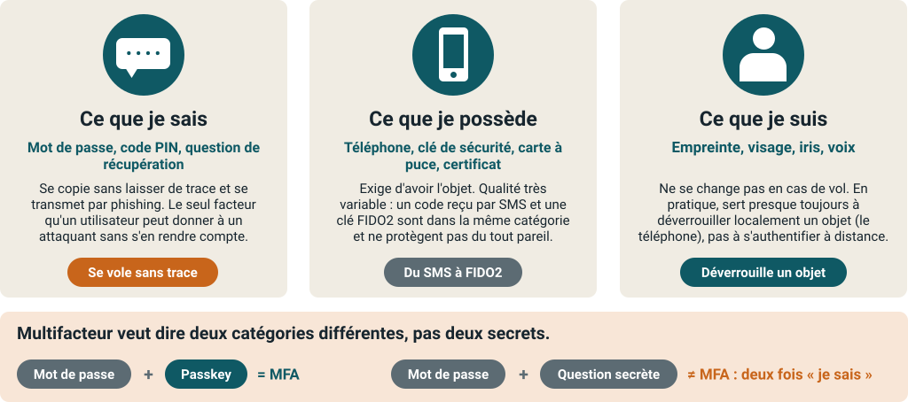

## L'authentification {.separateur}

[05]{.numero}

[Facteurs, mots de passe, MFA, passkeys, récupération de compte]{.sous-titre}

## Les trois facteurs d'authentification

[Authentification]{.surtitre}

::: {.cadre}
{.schema fig-alt="Trois cartes. Ce que je sais (mot de passe, code PIN, question de récupération) : se vole sans trace. Ce que je possède (téléphone, clé de sécurité, carte à puce, certificat) : du SMS à FIDO2. Ce que je suis (empreinte, visage, iris, voix) : déverrouille un objet. En bas : mot de passe plus passkey égale MFA ; mot de passe plus question secrète n'est pas du MFA, ce sont deux fois « je sais »."}
:::

## Mots de passe : les règles ont changé {style="--corps: 17.8px; --tete: 23.1px;"}

[Authentification]{.surtitre}

::: {.cadre}
::: {.grille .c2}
::: {.carte .panneau}
[Ce que recommande le NIST]{.tete}

- La longueur d'abord : viser 15 caractères ou plus, autoriser jusqu'à 64, accepter tous les caractères (espaces, accents).
- Comparer chaque nouveau mot de passe à une liste de mots de passe déjà volés.
- Pas de règles de composition imposées (majuscule, chiffre, caractère spécial).
- Pas de changement périodique : changer seulement si le mot de passe a été volé.
- Supprimer les questions secrètes : facteur faible et souvent public.
:::

::: {.carte .panneau .avant}
[Ce qu'on trouve encore en entreprise]{.tete}

- 8 caractères minimum, avec les quatre familles de caractères obligatoires.
- Changement obligatoire tous les 90 jours.
- Interdiction du copier-coller, ce qui empêche d'utiliser un gestionnaire de mots de passe.
- [**Résultat : Été2026! puis Automne2026! puis Hiver2026! La règle a produit exactement le comportement qu'elle voulait empêcher.**]{.ambre}
:::
:::

::: {.bandeau}
Source : NIST SP 800-63-4, version finale du 31 juillet 2025 (remplace la révision 3).
:::
:::

## Stocker un mot de passe correctement {style="--corps: 20.4px; --interligne: .6em;"}

[Authentification]{.surtitre}

::: {.cadre}
- **Un mot de passe ne se chiffre pas, il se hache.** Le chiffrement est réversible : si vous pouvez déchiffrer, un attaquant qui obtient la clé le peut aussi.
- **La fonction de hachage doit être lente et réglable.** SHA-256 est excellent pour vérifier l'intégrité d'un fichier, mais inadapté ici : il est trop rapide.
- **Fonctions adaptées :** Argon2id en premier choix, scrypt, bcrypt, PBKDF2 quand une norme l'impose.
- **Un sel unique par utilisateur :** deux mots de passe identiques donnent deux empreintes différentes, et les tables précalculées deviennent inutiles.
- **Un poivre (optionnel) :** un secret global stocké hors de la base, idéalement dans un boîtier matériel. Il protège encore si seule la base fuit.
- **Réviser les réglages régulièrement :** ce qui coûtait une seconde de calcul en 2018 n'en coûte qu'une fraction aujourd'hui.

::: {.bandeau}
Question d'examen classique : que se passe-t-il si la base fuit ? Avec Argon2id bien réglé et un sel par utilisateur, l'attaquant doit attaquer chaque compte séparément, à un coût prohibitif.
:::
:::

## Tous les MFA ne se valent pas {style="--corps: 16.9px; --pad-cellule: 5px; --espace-lignes: 5px;"}

[Authentification]{.surtitre}

::: {.cadre}
| Moyen                               | Ce qu'un attaquant peut en faire                                                                          | Niveau                           |
|----------------------------------|-------------------------------------------------------|-----------|
| SMS et appel vocal                  | Interception par vol de numéro (SIM swap) ou détournement réseau ; le code se transmet par phishing       | [Faible]{.niveau .faible}       |
| Code à usage unique (TOTP)          | Mieux que le SMS, mais l'utilisateur peut toujours taper son code sur un faux site                        | [Faible]{.niveau .faible}       |
| Notification « Approuver ? »        | Fatigue MFA : l'attaquant répète les demandes jusqu'à ce que l'utilisateur accepte pour avoir la paix     | [Faible]{.niveau .faible}       |
| Notification avec code à recopier   | L'utilisateur recopie un nombre affiché par le service. Bloque la fatigue MFA, pas le relais en temps réel | [Moyen]{.niveau .moyen}         |
| FIDO2, passkeys, carte à puce       | La preuve est liée cryptographiquement au nom de domaine du site. Un faux site n'obtient rien d'utilisable | [Résistant]{.niveau .fort}      |

::: {.bandeau}
Le bon critère n'est pas « combien de facteurs », mais « que peut faire un attaquant qui se place entre l'utilisateur et le site, en temps réel ? ».
:::
:::

## Comment on contourne un MFA en 2026 {style="--corps: 16px; --tete: 19.6px; --pastille: 43px;"}

[Authentification]{.surtitre}

::: {.cadre}
::: {.grille .c3}
::: {.carte}
[[1]{.pastille} Relais en temps réel]{.tete}

Un faux site s'intercale entre l'utilisateur et le vrai service, relaie mot de passe et code, puis vole le cookie de session. Le MFA a marché.
:::

::: {.carte}
[[2]{.pastille} Fatigue MFA]{.tete}

L'attaquant a déjà le mot de passe. Il déclenche des dizaines de notifications jusqu'à ce que l'utilisateur accepte, souvent la nuit.
:::

::: {.carte}
[[3]{.pastille} Vol de session]{.tete}

Le cookie ou le jeton est volé sur le poste par un logiciel espion, puis réutilisé ailleurs, sans nouvelle authentification.
:::

::: {.carte}
[[4]{.pastille} Appel au support]{.tete}

L'attaquant se fait passer pour un collaborateur en difficulté et fait réinitialiser le MFA. L'humain reste le maillon le plus rentable.
:::

::: {.carte}
[[5]{.pastille} Phishing au consentement]{.tete}

Aucun mot de passe tapé : l'utilisateur autorise une application malveillante à lire ses données. L'accès survit au changement de mot de passe.
:::

::: {.carte}
[[6]{.pastille} Vol de numéro (SIM swap)]{.tete}

Prise de contrôle du numéro auprès de l'opérateur : tous les codes SMS sont captés, y compris ceux de récupération de compte.
:::
:::

::: {.bandeau}
Quatre de ces six attaques échouent face à FIDO2 ou aux passkeys. C'est la mesure d'authentification au meilleur rapport coût / efficacité.
:::
:::

## FIDO2, WebAuthn, passkeys : comment ça marche {style="--corps: 17.8px; --tete: 19.6px; --pastille: 43px;"}

[Authentification]{.surtitre}

::: {.cadre}
::: {.grille style="grid-template-columns: repeat(4, 1fr); grid-template-rows: 201fr 227fr; gap: 27px 26px;"}
::: {.carte .avant}
[[1]{.pastille} Enregistrement]{.tete}

L'appareil (téléphone, clé) crée une paire de clés propre au site. La clé privée ne quitte jamais l'appareil.
:::

::: {.carte .avant}
[[2]{.pastille} Clé publique]{.tete}

Seule la clé publique est envoyée au service et stockée. Si la base fuit, elle ne contient aucun secret.
:::

::: {.carte .avant}
[[3]{.pastille} Défi]{.tete}

À la connexion, le service envoie un nombre aléatoire à signer (le défi).
:::

::: {.carte .avant}
[[4]{.pastille} Signature liée au site]{.tete}

L'appareil signe le défi avec le vrai nom de domaine du site. Un faux site obtient une signature invalide.
:::

::: {.carte .panneau}
[Ce que ça règle]{.tete}

Le phishing de mots de passe, le rejeu, les bases de mots de passe volées, la réutilisation entre sites.
:::

::: {.carte .panneau}
[Ce que ça ne règle pas]{.tete}

Le vol de session après connexion, un poste déjà infecté, et surtout la procédure de récupération de compte.
:::

::: {.carte .panneau}
[Point de vigilance]{.tete}

Une passkey synchronisée suit le compte personnel (Apple, Google). En entreprise : synchronisée ou liée à l'appareil ?
:::

::: {.carte .retenir}
[À retenir]{.tete}

Ce n'est pas de la magie : une signature cryptographique liée au nom de domaine. Aucun secret partagé à voler côté serveur.
:::
:::
:::

## Récupérer son accès : le maillon faible {style="--corps: 16.9px; --pad-cellule: 4px; --espace-lignes: 4px;"}

[Authentification]{.surtitre}

::: {.cadre}
| Moyen de récupération                              | Ce qu'un attaquant en fait                                                                                                                            | Niveau                      |
|--------------------------------------|----------------------------------------------------|----------|
| Lien par e-mail ou code SMS                        | Ramène tout au niveau de la boîte e-mail ou du SMS : c'est la porte que l'attaquant choisira à la place de la passkey                                 | [Faible]{.niveau .faible}  |
| Questions secrètes                                 | Réponses publiques ou devinables (réseaux sociaux, fuites de données)                                                                                 | [Faible]{.niveau .faible}  |
| Appel au support sans vérification                 | Ingénierie sociale : le support veut aider (MGM Resorts, 2023)                                                                                        | [Faible]{.niveau .faible}  |
| Codes de secours, seconde passkey                  | Enregistrés à l'avance. Il faut voler l'objet. À conserver hors du téléphone, à régénérer après usage                                                 | [Résistant]{.niveau .fort} |
| Validation du responsable, remise en main propre   | Le responsable valide dans l'outil IGA, le support remet un lien d'enrôlement en personne ou après vidéo-identification. Coûteux, mais aussi fort que l'enrôlement du premier jour | [Résistant]{.niveau .fort} |

::: {.bandeau}
Règle : la récupération doit être au moins aussi forte que l'authentification qu'elle remplace. Sinon l'attaquant ne force pas la porte blindée, il passe par la porte de secours.
:::
:::

## Concevoir une politique d'authentification {.exercice}

[Exercice]{.surtitre}

::: {.cadre .consigne}
::: {.carte}
**Durée :** 10 minutes en groupe, puis 5 à 10 minutes de discussion.

**La consigne :** [Concevoir une politique d'authentification](../exercices/politique-authentification.html){target="_blank"}, sur le site du cours.
:::
:::
