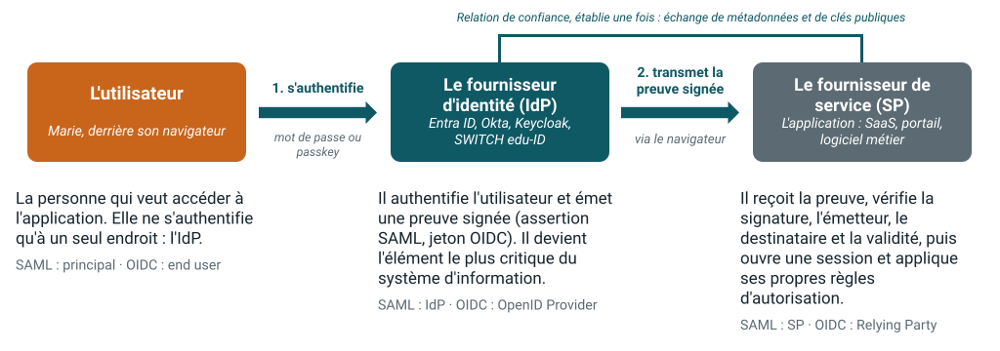

## Connecter, fédérer, gouverner {.separateur .partie}

[Partie 2]{.numero}

[SSO et fédération, protocoles, gouvernance, frontières actuelles, projet]{.sous-titre}

## Où en est Marie ? Le programme de la partie 2 {style="--corps: 16.9px; --tete-etape: 18.7px; --pastille: 40px; --rangs: 5;"}

[Fil rouge]{.surtitre}

::: {.cadre}
::: {.grille style="grid-template-columns: 371px 1fr; gap: 32px;"}
::: {.carte .chaude style="--corps: 18.7px;"}
[Acquis de la partie 1]{.tete}

- Marie a une identité dans le logiciel RH, des comptes créés automatiquement, des rôles qui portent ses droits.
- Elle s'authentifie avec une passkey, et nous savons pourquoi un code SMS ne suffit pas.
- Ce soir : comment ses 40 applications lui font confiance sans voir son mot de passe, comment garder le contrôle dans la durée, et comment mener le projet.
:::

::: {.etapes .c2 .reparties .vus5}
1. **1. Les bases**\
   Les mots, les quatre questions, la carte du domaine
2. **2. Où vivent les identités**\
   Sa fiche est créée dans le logiciel RH, qui fait foi
3. **3. Le cycle de vie**\
   Ses comptes sont créés ; elle change de poste ; elle part
4. **4. L'autorisation**\
   Ce qu'elle a le droit de faire : rôles, attributs, relations
5. **5. L'authentification**\
   Comment elle prouve que c'est elle, et ce qui résiste au phishing
6. **6. SSO et fédération**\
   Une seule connexion pour ses 40 applications
7. **7. Les protocoles**\
   SAML, OAuth, OpenID Connect, SCIM : comment ça circule
8. **8. Gouvernance et conformité**\
   Revues, journaux, comptes à privilèges, normes et lois
9. **9. Les frontières actuelles**\
   Zero Trust, cloud, clients, machines, e-ID suisse
10. **10. Mener un projet IAM**\
    Enjeux, acteurs, étapes, erreurs à éviter
:::
:::
:::

## Reprise : cinq questions en cinq minutes

[Partie 2]{.surtitre}

::: {.cadre .consigne}
::: {.carte}
**Durée :** 5 minutes.

**Les questions :** [Cinq questions de révision](../exercices/questions-de-revision.html){target="_blank"}, sur le site du cours.
:::
:::

## SSO et fédération {.separateur}

[06]{.numero}

[Une seule authentification pour toutes les applications]{.sous-titre}

## Le problème que la fédération résout {style="--corps: 19.6px; --tete: 23.1px;"}

[SSO]{.surtitre}

::: {.cadre}
::: {.grille .c2}
::: {.carte .panneau}
[Sans fédération]{.tete}

- Chaque application gère ses propres comptes : autant de bases de mots de passe, autant de fuites possibles, autant de comptes à fermer au départ d'un collaborateur.
- L'utilisateur réagit logiquement : il réutilise le même mot de passe partout. Une seule fuite compromet tout.
- L'informatique n'a aucune vue d'ensemble : impossible de répondre à « à quoi Marie a-t-elle encore accès ? ».
- Fermer les accès devient un inventaire manuel, fait dans l'urgence, donc incomplet.
- Imposer le MFA suppose de le déployer trente fois, dans trente produits différents.
:::

::: {.carte .panneau .avant}
[L'idée de la fédération]{.tete}

- Un seul système authentifie l'utilisateur.
- Toutes les applications lui font confiance et acceptent sa preuve signée, sans jamais voir le mot de passe.
- L'authentification devient un service central ; la politique de sécurité s'applique en un seul endroit.
:::
:::
:::

## Trois choses souvent confondues {style="--corps: 18.7px; --tete: 19.6px; --pastille: 43px;"}

[SSO]{.surtitre}

::: {.cadre}
::: {.grille .c3}
::: {.carte}
[[1]{.pastille} Authentification unique (SSO)]{.tete}

Une seule authentification donne accès à plusieurs applications à l'intérieur d'une même organisation.

Exemple : Kerberos dans un domaine Active Directory. L'utilisateur ouvre sa session et n'a plus rien à taper.
:::

::: {.carte}
[[2]{.pastille} Fédération d'identité]{.tete}

Le SSO franchit la frontière de l'organisation. Deux entités distinctes établissent une confiance explicite.

Exemple : se connecter à un service SaaS avec le compte de son employeur, ou SWITCH edu-ID entre hautes écoles suisses.
:::

::: {.carte}
[[3]{.pastille} Gestionnaire de mots de passe]{.tete}

L'outil connaît le mot de passe de chaque application et le tape à la place de l'utilisateur.

Ce n'est pas de la fédération : les comptes locaux existent toujours et devront être fermés un par un.
:::
:::

::: {.bandeau}
Le gestionnaire de mots de passe règle un problème de confort. Seule la fédération règle le problème de gouvernance, parce qu'elle supprime les comptes locaux au lieu de les cacher.
:::
:::

## Les trois rôles de toute fédération

[SSO]{.surtitre}

::: {.cadre}
{.schema fig-alt="Trois rôles. L'utilisateur (Marie, derrière son navigateur) s'authentifie par mot de passe ou passkey auprès du fournisseur d'identité, l'IdP (Entra ID, Okta, Keycloak, SWITCH edu-ID). L'IdP transmet la preuve signée, via le navigateur, au fournisseur de service, le SP (l'application : SaaS, portail, logiciel métier). Entre l'IdP et le SP, une relation de confiance établie une fois : échange de métadonnées et de clés publiques."}

::: {.bandeau}
L'application ne voit jamais le mot de passe : seulement une preuve signée qu'elle vérifie. Le revers : l'IdP devient le point unique de panne, et de compromission, de tout le système d'information.
:::
:::

## Sous le capot du SSO web : sessions et cookies {style="--corps: 17.8px; --pastille: 43px; --ecart: 14px; --rangs: 3;"}

[SSO]{.surtitre}

::: {.cadre}
::: {.etapes .c2 .reparties}
1. L'utilisateur demande une page. Un composant placé devant l'application (agent, reverse proxy ou bibliothèque) intercepte la demande : c'est le point d'application (PEP).
2. Pas de cookie de session valide : le PEP renvoie l'utilisateur vers le serveur d'authentification (l'IdP), qui joue le rôle de point de décision (PDP).
3. L'utilisateur s'authentifie une seule fois. L'IdP crée sa propre session, matérialisée par un cookie sur le domaine de l'IdP.
4. L'IdP renvoie l'utilisateur à l'application avec une preuve (assertion SAML ou jeton OIDC). L'application crée sa propre session locale : un second cookie.
5. Pour la deuxième application, l'IdP a déjà une session : la preuve est émise sans rien demander. C'est cela, l'authentification unique.
6. Déconnexion : il faut fermer la session de l'IdP et toutes les sessions locales (déconnexion globale), sinon l'utilisateur reste connecté à certaines applications.
:::

::: {.bandeau}
Il existe toujours au moins deux sessions (IdP et application). Durées de vie, révocation et déconnexion doivent être pensées pour les deux.
:::
:::
