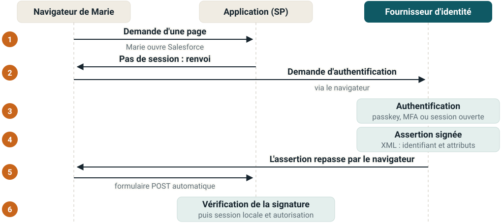
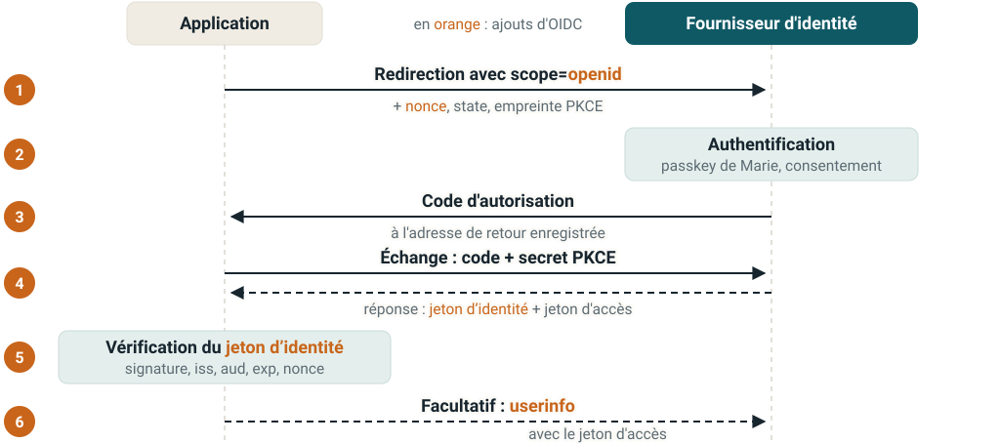
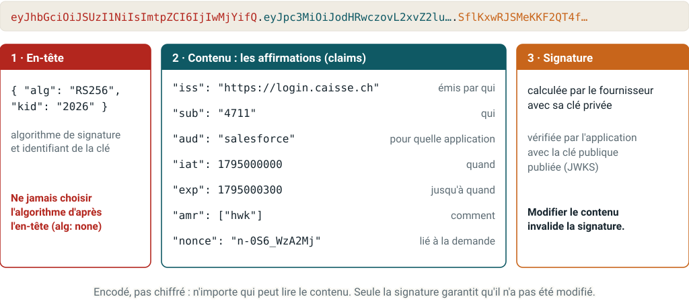
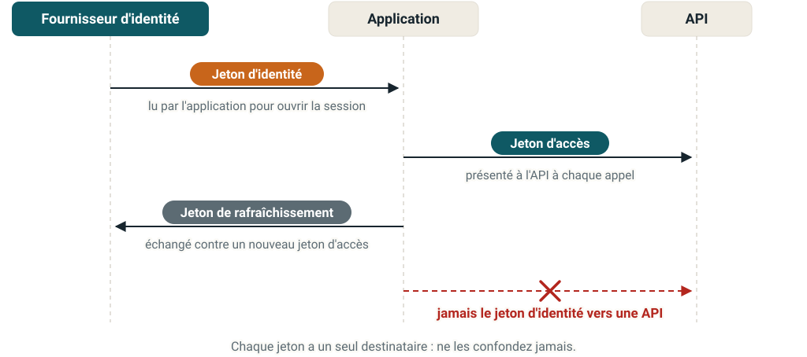

## Les protocoles {.separateur}

[07]{.numero}

[SAML 2.0, OAuth 2.0, OpenID Connect, SCIM]{.sous-titre}

::: {.bandeau}
[Fil rouge :]{.fil-rouge} *Comment les applications font confiance à l'IdP, et comment les comptes de Marie y arrivent.*
:::

## SAML 2.0 : l'échange, étape par étape {style="--corps: 18.7px; --pastille: 43px; --rangs: 3;"}

[Protocoles]{.surtitre}

::: {.cadre}
::: {.etapes .c2 .reparties}
1. L'utilisateur demande une page à l'application (le fournisseur de service).
2. L'application voit qu'il n'a pas de session et le renvoie vers le fournisseur d'identité avec une demande d'authentification.
3. Le fournisseur d'identité authentifie l'utilisateur : mot de passe, MFA, ou session déjà ouverte.
4. Il produit une « assertion » : un document XML signé qui contient l'identifiant et les attributs demandés.
5. Le navigateur transmet l'assertion à l'application, en général via un formulaire envoyé automatiquement.
6. L'application vérifie la signature, ouvre une session locale et applique ses propres règles d'autorisation.
:::

::: {.bandeau}
Variante : l'échange démarre depuis le portail d'entreprise (initié par l'IdP). Plus pratique, mais l'étape 2 disparaît, et avec elle le lien entre la demande et la réponse : c'est une surface d'attaque en plus.
:::
:::

## SAML 2.0 : le flux

[Protocoles]{.surtitre}

::: {.cadre}
{.schema fig-alt="Flux SAML en six étapes entre le navigateur de Marie, l'application et le fournisseur d'identité. Demande d'une page, renvoi vers le fournisseur avec une demande d'authentification, authentification, assertion XML signée, assertion transmise par le navigateur via un formulaire POST, vérification de la signature par l'application. L'application et le fournisseur ne se parlent pas directement."}
:::

## SAML : ce qu'il faut vérifier {style="--corps: 18.7px; --tete: 23.1px;"}

[Protocoles]{.surtitre}

::: {.cadre}
::: {.grille .c2}
::: {.carte .panneau}
[Ce que contient l'assertion]{.tete}

- **Issuer :** qui l'a émise.
- **Subject :** de qui il s'agit.
- **Conditions :** période de validité et destinataire attendu.
- **AuthnStatement :** comment l'utilisateur a été authentifié, et quand.
- **AttributeStatement :** les attributs transmis.
- **Signature :** la garantie que rien n'a été modifié et que l'émetteur est le bon.
:::

::: {.carte .panneau .avant}
[Erreurs classiques d'intégration]{.tete}

- Signature non vérifiée, ou vérifiée sur le message et non sur l'assertion.
- Destinataire non contrôlé, ce qui permet de réutiliser une assertion sur une autre application.
- Pas de protection contre le rejeu de la même assertion.
- Certificat de signature expiré, renouvelé dans l'urgence un vendredi soir.
- Déconnexion globale jamais mise en place : la session locale survit à la déconnexion centrale.
:::
:::

::: {.bandeau}
Le certificat de signature de l'IdP a une date d'expiration. Le jour où il expire, toutes les applications fédérées tombent en même temps. Cette date doit être dans un agenda, pas seulement dans un fichier de configuration.
:::
:::

## OAuth 2.0 : le malentendu de départ {style="--corps: 19.6px; --tete: 23.1px;"}

[Protocoles]{.surtitre}

::: {.cadre}
::: {.grille .c2}
::: {.carte .panneau}
[Ce qu'OAuth 2.0 fait]{.tete}

- Il délègue un droit d'accès à une ressource.
- Cas d'usage d'origine : permettre à une application de lire mon agenda sans lui donner mon mot de passe.
- Il produit un jeton d'accès (access token) destiné à une API.
- Ce jeton dit ce que son porteur peut faire, dans quelles limites (les « scopes »), et jusqu'à quand.
:::

::: {.carte .panneau .avant}
[Ce qu'OAuth 2.0 ne fait pas]{.tete}

- Il ne dit pas qui est l'utilisateur, ni comment il a été authentifié, ni même s'il l'a été.
- Le jeton d'accès n'est pas destiné à l'application cliente mais à l'API. L'application ne doit pas le lire pour identifier l'utilisateur.
- Utiliser OAuth 2.0 seul pour authentifier est une erreur de conception connue depuis plus de dix ans, et toujours très répandue.
- C'est exactement le vide que comble OpenID Connect.
:::
:::

::: {.bandeau}
Formule à retenir : OAuth donne un ticket de consigne, pas une carte d'identité.
:::
:::

## Le flux à retenir : code d'autorisation + PKCE {style="--corps: 16.9px; --tete-etape: 17.8px; --pastille: 43px; --ecart: 12px;"}

[Protocoles]{.surtitre}

::: {.cadre}
::: {.etapes .reparties style="--rangs: 5;"}
1. **Redirection**\
   L'application envoie l'utilisateur vers le serveur d'autorisation, avec l'empreinte d'un secret qu'elle vient de tirer au hasard (le « code challenge »).
2. **Consentement**\
   L'utilisateur s'authentifie auprès du serveur d'autorisation et accepte les droits demandés.
3. **Code**\
   Le serveur renvoie un code d'autorisation à usage unique, valable très peu de temps, à l'adresse de retour enregistrée à l'avance.
4. **Échange**\
   L'application échange le code contre un jeton, en présentant cette fois le secret en clair. Le serveur vérifie qu'il correspond à l'empreinte de l'étape 1.
5. **Appel**\
   L'application appelle l'API avec le jeton d'accès. L'API le vérifie.
:::

::: {.bandeau}
Ce que PKCE empêche : un attaquant qui intercepte le code ne peut rien en faire, car il ne connaît pas le secret d'origine. Le code seul devient inutilisable.
:::
:::

## Ce qui a été abandonné : vers OAuth 2.1 {style="--corps: 16.9px; --pad-cellule: 6px; --espace-lignes: 5px;"}

[Protocoles]{.surtitre}

::: {.cadre}
| Élément                                  | Statut                                     | Raison                                                    |
|-------------------------------------|--------------------|-------------------------------------------|
| Flux implicite (response_type=token)     | [À ne plus utiliser]{.niveau .faible}      | Le jeton passe dans l'URL : historique, journaux du proxy |
| Mot de passe via l'application (ROPC)    | [À ne plus utiliser]{.niveau .faible}      | L'application manipule le mot de passe : plus aucun intérêt |
| PKCE                                     | [Obligatoire]{.niveau .fort}               | Pour tous les clients, plus seulement le mobile           |
| Adresse de retour (redirect URI)         | [Comparaison exacte]{.niveau .fort}        | Avec un joker, le code part chez l'attaquant              |
| Jeton de rafraîchissement (client public) | [Rotation obligatoire]{.niveau .fort}     | Un jeton longue durée volé : accès durable et discret     |
| Jeton dans l'URL                         | [Interdit]{.niveau .faible}                | Même problème que le flux implicite : fuite invisible     |

::: {.bandeau}
OAuth 2.1 est encore un projet à l'IETF au moment de ce cours. Son intérêt est ailleurs : il liste noir sur blanc ce qu'il faut retirer d'une intégration existante.
:::
:::

## OpenID Connect : la couche d'authentification {style="--corps: 17.8px; --tete: 19.6px; --pastille: 43px;"}

[Protocoles]{.surtitre}

::: {.cadre}
::: {.grille .c3}
::: {.carte}
[[1]{.pastille} Le jeton d'identité (ID token)]{.tete}

Un JWT signé qui décrit l'authentification : qui (sub), émis par qui (iss), pour quelle application (aud), quand (iat), jusqu'à quand (exp), comment (amr, acr), et avec quel code aléatoire (nonce).

C'est ce jeton, et lui seul, que l'application doit vérifier pour identifier l'utilisateur.
:::

::: {.carte}
[[2]{.pastille} Le point d'information (userinfo)]{.tete}

Un service standard qui renvoie les attributs de l'utilisateur, regroupés par familles : profile, email, address, phone.

Fini les correspondances d'attributs à réinventer pour chaque application, qui étaient la plaie de SAML.
:::

::: {.carte}
[[3]{.pastille} Découverte et clés publiques]{.tete}

Un document publié à une adresse convenue décrit tous les points d'accès du fournisseur ; un second expose ses clés publiques de signature.

L'intégration devient automatisable, et le changement des clés cesse d'être une opération manuelle à risque.
:::
:::

::: {.bandeau}
Règle : le jeton d'identité authentifie l'utilisateur auprès de l'application. Le jeton d'accès autorise l'application auprès d'une API. Ne jamais confondre les deux usages.
:::
:::

## OpenID Connect : le flux

[Protocoles]{.surtitre}

::: {.cadre}
{.schema fig-alt="Flux OpenID Connect en six étapes entre l'application et le fournisseur d'identité. Redirection avec scope openid, nonce, state et empreinte PKCE ; authentification de Marie ; code d'autorisation ; échange du code contre un jeton d'identité et un jeton d'accès ; vérification du jeton d'identité (signature, iss, aud, exp, nonce) ; appel facultatif à userinfo avec le jeton d'accès."}
:::

## Anatomie d'un jeton d'identité

[Protocoles]{.surtitre}

::: {.cadre}
{.schema fig-alt="Un jeton d'identité en trois parties Base64URL séparées par des points. En-tête : algorithme RS256 et identifiant de clé ; ne jamais choisir l'algorithme d'après l'en-tête. Contenu : iss, sub, aud, iat, exp, amr, nonce. Signature : calculée avec la clé privée du fournisseur, vérifiée avec sa clé publique (JWKS). Encodé, pas chiffré."}
:::

## Chaque jeton a son destinataire

[Protocoles]{.surtitre}

::: {.cadre}
{.schema fig-alt="Le jeton d'identité va du fournisseur à l'application ; le jeton d'accès va de l'application à l'API ; le jeton de rafraîchissement revient au fournisseur contre un nouveau jeton d'accès. Jamais le jeton d'identité vers une API."}
:::

## Les trois jetons et comment les vérifier {style="--corps: 16.9px; --pad-cellule: 8px;"}

[Protocoles]{.surtitre}

::: {.cadre}
| Jeton                                      | Destinataire                | Rôle                                                              | Durée de vie                                   |
|--------------------------------|--------------------|------------------------------|------------------|
| Jeton d'identité (ID token)                | L'application cliente       | Prouver qu'une authentification a eu lieu, et dans quel contexte  | Très courte, usage unique à la connexion       |
| Jeton d'accès (access token)               | L'API                       | Autoriser des appels d'API dans les limites des droits accordés   | Quelques minutes à une heure                   |
| Jeton de rafraîchissement (refresh token)  | Le serveur d'autorisation   | Obtenir un nouveau jeton d'accès sans se réauthentifier           | Longue, d'où la nécessité de le renouveler     |

::: {.carte .avant style="--corps: 15.1px; --interligne: .35em; margin-top: auto;"}
- Un JWT est signé et encodé, pas chiffré. N'importe qui peut lire son contenu : n'y mettez jamais de donnée sensible ni de secret.
- Vérification minimale côté serveur : la signature (clé publique du fournisseur), puis l'émetteur, le destinataire, la date d'expiration et, pour un jeton d'identité, le nonce.
- Ne jamais se fier à l'en-tête du jeton pour choisir l'algorithme : c'est l'origine de la faille classique où l'algorithme est mis à « aucun ».
- Un jeton signé ne se révoque pas : il reste valable jusqu'à son expiration. D'où des durées courtes, et une vérification côté serveur quand il faut révoquer immédiatement.
:::
:::

## SCIM : créer et fermer les comptes en standard {style="--corps: 17.8px; --tete: 23.1px;"}

[Protocoles]{.surtitre}

::: {.cadre}
::: {.grille .c2}
::: {.carte .panneau}
[Le problème]{.tete}

- SAML et OIDC ne répondent pas à une question : comment créer, mettre à jour et désactiver le compte dans l'application cible ?
- SCIM est une API REST standard, avec deux objets principaux (Utilisateur et Groupe) et un schéma d'attributs commun. Trois RFC de 2015.
- Sans SCIM, il reste deux mauvaises solutions : le fichier déposé chaque nuit, ou la création automatique du compte à la première connexion.
- Cette création à la volée est confortable et dangereuse : elle sait ouvrir un compte, jamais le fermer. Les comptes orphelins s'accumulent.
- Attention : la prise en charge de SCIM par les éditeurs est très inégale. La désactivation, en particulier, manque souvent.
:::

::: {.carte .panneau .avant style="--corps: 18.7px;"}
[La règle des deux canaux]{.tete}

- **SAML ou OIDC :** le canal d'authentification, à chaque connexion.
- **SCIM :** le canal du cycle de vie, à chaque événement RH.
- Les deux sont nécessaires. Une intégration qui n'a que le premier fabrique des comptes orphelins.
- [**À vérifier dans tout contrat SaaS : le fournisseur propose-t-il SCIM, et sa version gère-t-elle vraiment la désactivation ?**]{.ambre}
:::
:::
:::

## Quel protocole pour quel usage {style="--corps: 16px; --pad-cellule: 7px;"}

[Synthèse]{.surtitre}

::: {.cadre}
| Besoin                                       | Protocole                   | Remarque                                                                      |
|----------------------------------------|----------------------|--------------------------------------|
| Connecter un logiciel d'entreprise à l'IdP   | SAML 2.0                    | Le plus largement pris en charge par les applications installées en entreprise |
| Authentifier sur une application web ou mobile | OpenID Connect            | Plus léger, adapté au mobile et aux applications web modernes                 |
| Autoriser l'appel d'une API                  | OAuth 2.0 / 2.1             | Code d'autorisation avec PKCE. Jamais le flux implicite                       |
| Créer, modifier et désactiver des comptes    | SCIM 2.0                    | Indispensable en complément de la fédération, jamais à sa place               |
| Authentifier une machine, sans utilisateur   | OAuth client credentials    | Avec un certificat plutôt qu'un secret partagé                                |
| SSO dans un domaine Windows                  | Kerberos                    | Ancien, efficace, limité au réseau interne et aux machines du domaine         |
| Résister au phishing à la connexion          | FIDO2 / WebAuthn            | S'ajoute aux précédents : c'est le facteur, pas le protocole de fédération    |
:::

## Quatre attaques sur les protocoles de fédération {style="--corps: 16px; --tete: 19.6px; --pastille: 43px; --lh: 1.24; --tete-marge: 8px;"}

[Protocoles]{.surtitre}

::: {.cadre}
::: {.grille .c2}
::: {.carte}
[[1]{.pastille} Détournement de l'adresse de retour]{.tete}

Une adresse de retour comparée approximativement livre le code d'autorisation à un domaine de l'attaquant.\
**Parade : comparaison exacte, sans joker.**
:::

::: {.carte}
[[2]{.pastille} L'intermédiaire trompé]{.tete}

Un service de confiance utilise ses propres droits pour le compte d'un tiers, sans vérifier au nom de qui il agit (confused deputy).\
**Parade : un jeton au nom de l'utilisateur, pas l'identité du service.**
:::

::: {.carte}
[[3]{.pastille} Phishing au consentement]{.tete}

Une application malveillante obtient le droit de lire les e-mails. Aucun mot de passe volé ; l'accès survit à son changement.\
**Parade : liste blanche d'applications, validation des droits sensibles.**
:::

::: {.carte}
[[4]{.pastille} Rejeu de jeton et de session]{.tete}

Un jeton ou un cookie volé est réutilisé depuis un autre appareil. L'authentification forte a déjà eu lieu.\
**Parade : jeton lié au client, durées courtes, réévaluation du contexte.**
:::
:::

::: {.bandeau}
Point commun aux quatre : l'authentification était correcte. La faille est dans la délégation, c'est-à-dire dans l'autorisation. C'est ce qui la rend si difficile à détecter.
:::
:::
